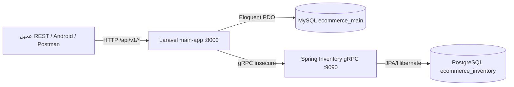
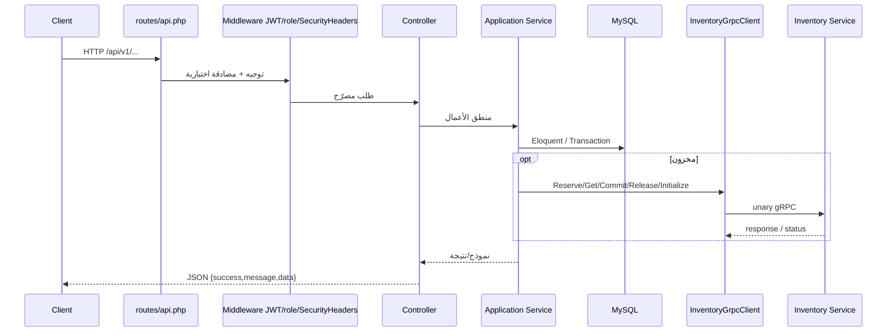

# 00 — خريطة معمارية المشروع

**نوع الوثيقة:** تدقيق معماري مبني على الشيفرة المصدرية  
**الفرع:** `main` (`cb0dbb9`)  
**تاريخ التدقيق:** 2026-11-10  
**قيود التدقيق:** لم يُعدَّل أي كود تطبيقي أو إعدادات بنية تحتية. لم تُنفَّذ اختبارات لأن `vendor/` غير موجود محلياً وحاويات Docker غير شغّالة أثناء التدقيق.

---

## 1. الملخص التنفيذي

المشروع منصة تجارة إلكترونية جامعية مكوّنة من خدمتين مستقلتين:

| الخدمة | التقنية | قاعدة البيانات | البروتوكول الخارجي |
| --- | --- | --- | --- |
| `main-app/laravel` | PHP 8.3 (صورة Docker) / Laravel 12.71 / JWT | MySQL 8.4 (`ecommerce_main`) | REST HTTP على المنفذ `8000` |
| `inventory-service` | Java 21 / Spring Boot 4.0.9 / Spring gRPC | PostgreSQL 16 (`ecommerce_inventory`) | gRPC على المنفذ `9090` |

عقد التواصل المشترك: `proto/inventory.proto`.

**التحقق من الحالة:** المتطلب 1 (API والأمان) مُنفَّذ جزئياً بقوة في المسارات الأساسية، مع فجوات واضحة في الإشعارات وتاريخ حالة الطلبات والفرز وSwagger. المتطلب 2 (التواصل بين الخدمات) مُنفَّذ جوهرياً مع آلية قفل متشائم ومنطق تعويض، مع خلل معروف عند ضياع رد `ReserveStock` بعد نجاح الحجز. المتطلب 3 (الأداء والتخزين المؤقت) **غير منفَّذ**.

---

## 2. التقنيات والإصدارات الموثَّقة من المصدر

| المكوّن | الإصدار / القيمة | مصدر التحقق |
| --- | --- | --- |
| PHP (صورة التطبيق) | `php:8.3-cli` | `main-app/laravel/Dockerfile` سطر 1 |
| Laravel Framework | `v12.71.0` | `composer.lock` |
| JWT Auth | `php-open-source-saver/jwt-auth` `v2.10.0` | `composer.lock` |
| gRPC PHP | `grpc/grpc` ^1.85 + امتداد pecl | `composer.json` + Dockerfile |
| Java | 21 | `inventory-service/pom.xml` + Dockerfile |
| Spring Boot | 4.0.9 | `pom.xml` parent |
| Spring gRPC | 1.0.3 BOM | `pom.xml` |
| MySQL | 8.4 | `docker-compose.yml` |
| PostgreSQL | 16 | `docker-compose.yml` |
| JWT TTL الافتراضي | 60 دقيقة عبر `JWT_TTL` | `config/jwt.php` سطر 92 |
| مهلة gRPC الافتراضية | `3000000` ميكروثانية (= 3 ثوانٍ) | `config/services.php` |

> ملاحظة: `.env.example` لا يحتوي مفاتيح `INVENTORY_GRPC_*` ولا `JWT_SECRET` صراحةً. داخل Docker يعمل المضيف الافتراضي `inventory-service:9090`. توليد المفاتيح موثَّق في `README.md` الجذري.

---

## 3. خريطة المستودع

```
Web_Applications_New/
├── docker-compose.yml          # تنسيق الخدمات الأربع + الشبكة + المجلدات
├── README.md                   # دليل تشغيل للفريق الأندرويد (موثَّق وليس دليلاً معمارياً كاملاً)
├── Ecommerce.postman_collection.json
├── Ecommerce.Frontend.postman_collection.json
├── Auth.postman_collection.json
├── proto/inventory.proto       # عقد gRPC الرسمي
├── adversarial-qa/             # اختبارات عدائية k6 + مرحل أعطال gRPC
├── postman/fixtures/           # ملفات رفع للاختبار
├── inventory-service/          # خدمة المخزون Java
└── main-app/laravel/           # تطبيق Laravel الرئيسي
```

### مسؤوليات المجلدات الرئيسية

| المسار | المسؤولية | المتطلب |
| --- | --- | --- |
| `main-app/laravel/app/Modules/Users` | تسجيل/دخول/JWT | 1 |
| `main-app/laravel/app/Modules/Products` | فئات ومنتجات ورفع صور | 1 + قراءة مخزون (2) |
| `main-app/laravel/app/Modules/Orders` | سلة وطلبات وتحولات الحالة | 1 + حجز مخزون (2) |
| `main-app/laravel/app/Modules/Notifications` | ملف مسارات فارغ فقط | 1 (غير منفَّذ) |
| `main-app/laravel/app/Modules/Inventory` | عميل gRPC واستثناءات | 2 |
| `main-app/laravel/app/Grpc/Generated` | عميل Protobuf مولَّد | 2 |
| `inventory-service/src/main/java/...` | خادم gRPC + منطق المخزون | 2 |
| `adversarial-qa/` | إثبات سباقات وتعويض وأعطال | 2 (أدلة عملية) |
| `docs/audit/` | تقارير هذا التدقيق | توثيق |

---

## 4. مخطط المعمارية (Mermaid)



---

## 5. بنية Docker

خدمات `docker-compose.yml` (`name: ecommerce2026`):

| خدمة | صورة/بناء | منافذ المضيف | يعتمد على | مجلد دائم |
| --- | --- | --- | --- | --- |
| `mysql` | `mysql:8.4` | `127.0.0.1:3307→3306` | — | `mysql_data` |
| `inventory-db` | `postgres:16` | `127.0.0.1:5433→5432` | — | `postgres_data` |
| `app` | بناء `main-app/laravel/Dockerfile` | `127.0.0.1:8000→8000` | `mysql` (healthy) | bind mount + `laravel_vendor` |
| `inventory-service` | بناء من الجذر عبر `inventory-service/Dockerfile` | `127.0.0.1:9090→9090` | `inventory-db` (healthy) | — |

ملاحظات معمارية مهمة (موثَّقة من المصدر):

1. خدمة `app` **لا** تحتوي `depends_on: inventory-service`؛ الاعتماد تشغيلي فقط.
2. لا توجد خدمة Redis ولا Read Replica في Compose.
3. لا يوجد healthcheck صريح لحاوية `app` أو `inventory-service` بخلاف قواعد البيانات.
4. كلمات مرور قواعد البيانات موجودة كنصوص داخل Compose للتطوير المحلي — لا تُعاد في هذا التقرير.

---

## 6. معماريات قواعد البيانات

### 6.1 قاعدة Laravel (MySQL)

| الجدول | الغرض | مفاتيح / قيود مهمة |
| --- | --- | --- |
| `users` | حسابات | `email` unique، `role` مفهرس، افتراضي `customer` |
| `categories` | فئات | `name` unique |
| `products` | كتالوج | FK `category_id`، فهرس `(category_id, created_at)`، حقول idempotency: `creation_key` unique، `pending_initial_quantity`، `creation_fingerprint` |
| `carts` | سلة لكل مستخدم | `user_id` unique |
| `cart_items` | بنود السلة | unique `(cart_id, product_id)` |
| `orders` | طلبات | `reservation_id` unique، فهرس `status`، فهرس `(user_id, created_at)` |
| `order_items` | بنود الطلب مع لقطة السعر/الاسم | FK `order_id` cascade، FK `product_id` restrict |
| `cache` / `cache_locks` | كاش قاعدة البيانات الافتراضي | — |
| `jobs` / `job_batches` / `failed_jobs` | طوابير Laravel | غير مستخدمة لمنطق أعمال واضح حالياً |
| `sessions` / `password_reset_tokens` | بنية Laravel الافتراضية | — |

**غير موجود:** جدول `order_status_histories` أو أي سجل تاريخ حالات.

### 6.2 قاعدة Inventory (PostgreSQL عبر Hibernate `ddl-auto: update`)

| الجدول | الغرض |
| --- | --- |
| `inventory_stock` | `product_id` unique، `total_quantity`، `reserved_quantity`، قيود CHECK للكميات |
| `inventory_reservations` | صف لكل منتج داخل `reservation_id`، حالة `ACTIVE|RELEASED|COMMITTED`، unique `(reservation_id, product_id)` |

الكمية المتاحة محسوبة عابراً: `total - reserved` (`InventoryStock.getAvailableQuantity`).

---

## 7. دورة حياة الطلب HTTP النموذجية



نقطة الدخول: `bootstrap/app.php` يسجّل مسارات `api` من `routes/api.php` تحت بادئة Laravel الافتراضية `/api`، ثم المجموعة `v1`.

---

## 8. التواصل بين الخدمات

1. Laravel يبني `InventoryServiceClient` عبر `InventoryGrpcClient::client()` بمضيف `config('services.inventory.host')` وبيانات اعتماد **غير مشفّرة** (`ChannelCredentials::createInsecure()`).
2. كل استدعاء unary يمرّر `timeout` من الإعداد.
3. أكواد gRPC غير `STATUS_OK` تُحوَّل إلى `InventoryServiceException` → HTTP **503**.
4. ردود الأعمال `success=false` (مثل نقص المخزون) تُحوَّل إلى `InventoryRejectedException` → HTTP **409**.

RPCs المستخدمة فعلياً من Laravel:

| RPC | مستدعى من |
| --- | --- |
| `GetStock` | `ProductService::findById` |
| `InitializeStock` | `ProductService::finishInitialStock` |
| `ReserveStock` | `OrderService::createOrder` |
| `ReleaseStock` | تعويض فشل إنشاء الطلب + إلغاء الطلب |
| `CommitReservation` | عند تحويل الحالة إلى `shipped` |
| `AddStock` | متاح في العميل؛ مسار REST إداري مباشر غير موجود |

---

## 9. تنظيم الوحدات داخل Laravel

التنظيم **مجلدات منطقية** تحت `app/Modules/*` وليست حزم Laravel منفصلة أو حدود نشر مستقلة. لا توجد Policies/Gates؛ التفويض عبر:

- Middleware `auth:api`
- Middleware `role:admin` (`EnsureUserHasRole`)
- تصفية ملكية الطلب في `OrderService::getUserOrder` بـ `where('user_id', ...)`

أنماط مستخدمة: Controller → FormRequest → Service → Eloquent/Resource؛ عميل gRPC كـ Anti-Corruption Layer للمخزون؛ تعويض (compensating action) بعد فشل استمرار الطلب.

---

## 10. قرارات تصميم مهمة

1. **المخزون خارج MySQL بالكامل**؛ المنتج لا يخزّن كمية متاحة محلياً باستثناء `pending_initial_quantity` أثناء التهيئة.
2. **الحجز ثم الخصم النهائي عند الشحن**: الحالة `pending/confirmed/processing` تبقي الحجز `ACTIVE`؛ `shipped` يستدعي `CommitReservation`؛ `cancelled` يستدعي `ReleaseStock`.
3. **منتجات غير منشورة** طالما `pending_initial_quantity IS NOT NULL` (`Product::scopePublished`).
4. **Idempotency** لإنشاء المنتج عبر ترويسة `Idempotency-Key`، وليس لإنشاء الطلب.
5. الكاش الافتراضي هو `database` وليس Redis.

---

## 11. قيود تقنية معروفة

| القيد | التحقق |
| --- | --- |
| وحدة Notifications فارغة | `Modules/Notifications/Routes/api.php` ملف فارغ |
| لا يوجد تاريخ حالات الطلب | لا migration ولا علاقة في `Order` |
| لا يوجد معامل فرز للمنتجات | `ProductService::getAll` يفرض `latest()->orderByDesc('id')` فقط |
| لا Swagger/OpenAPI | التوثيق عبر Postman فقط |
| استدعاء gRPC داخل معاملة MySQL | `OrderService::createOrder` يحجز أقفال صفوف أثناء الشبكة |
| خلل مهلة الحجز المعروف | مجلد Postman `08 gRPC Deadline - Known Bug` + منطق `reservationCreated` |
| لا Redis / Replica / ETag / k6 لأداء المتطلب 3 | Compose + الكود |
| اختبارات Java شكلية فقط | `contextLoads` |
| اختبارات Laravel لا تغطي التكامل الحقيقي مع gRPC | تستخدم Mockery في `ProductApiTest` |

---

## 12. حالة التحقق لهذا المستند

| الادعاء | الحالة |
| --- | --- |
| بنية المجلدات والخدمات | **Verified by source code** |
| إصدارات الحزم الرئيسية | **Verified by source code** (`composer.lock` / `pom.xml`) |
| سلوك التشغيل الحي | **Unable to determine** (Docker متوقف، لا `.env`، لا `vendor/`) |
| نتائج اختبارات | لم تُنفَّذ — انظر `01` و`02` و`04` |
