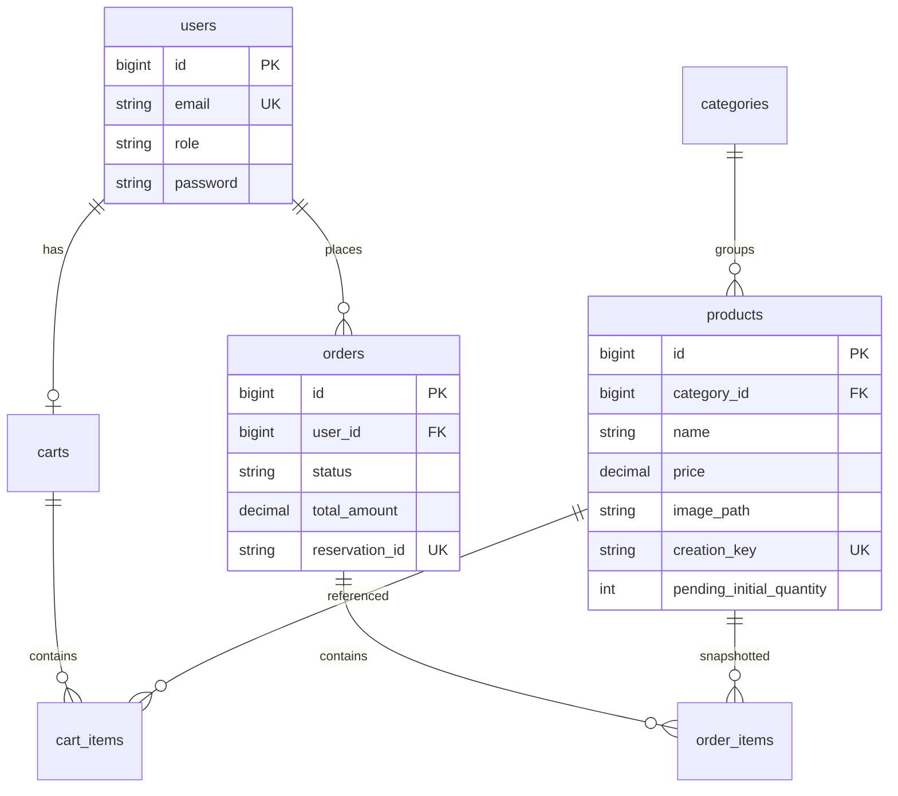

# 01 — تدقيق المتطلب 1: تصميم الواجهة البرمجية والأمان

**حالة التنفيذ الإجمالية:** **جزئي / قوي في المسارات الأساسية، غير مكتمل وفق معايير القبول الرسمية**  
**أساس التحقق:** الشيفرة المصدرية + مجموعات Postman + اختبارات Feature (قراءة فقط؛ لم تُنفَّذ).

---

## 1. معايير المتطلب الرسمية ومصفوفة الامتثال

| # | المعيار المتوقع | التنفيذ الفعلي | الدليل | الحالة | الشدة إن ناقص | إجراء مقترح |
| --- | --- | --- | --- | --- | --- | --- |
| 1.1 | أربع وحدات منطقية: Users, Products, Orders, Notifications | ثلاث وحدات فعّالة؛ Notifications ملف مسارات فارغ | `routes/api.php`؛ `Modules/Notifications/Routes/api.php` فارغ | **Partially implemented** | عالية | تنفيذ API إشعارات أو توثيق استثناء رسمي إن سمح المقرر |
| 1.2 | REST لإدارة المنتجات والطلبات | موجود (إنشاء/قائمة/تفاصيل منتجات؛ سلة؛ طلبات؛ تحديث حالة) | مسارات Modules | **Verified by source code** | — | لا يوجد تحديث/حذف منتج |
| 1.3 | رفع صور منتجات | `StoreProductRequest` + `store('products','public')` | `ProductService::create` | **Verified by source code** | — | — |
| 1.4 | تصفية حسب الفئة | `category_id` في `ProductController::index` | سطور 21–28 | **Verified by source code** | — | — |
| 1.5 | ترقيم صفحات | `paginate` للمنتجات (افتراضي 12، أقصى 50) والفئات (15) والطلبات | Services | **Verified by source code** | — | — |
| 1.6 | فرز Sorting | غير معرّض كمعامل API؛ ترتيب ثابت `latest` ثم `id desc` | `ProductService::getAll` | **Not implemented** (كمُعامل مطلوب) | متوسطة | إضافة `sort`/`order` موثّق مع فهارس |
| 1.7 | تحولات حالة الطلب | آلة حالات في `OrderService::updateStatus` | سطور 177–214 | **Verified by source code** | — | — |
| 1.8 | تاريخ حالة الطلب | لا جدول ولا سجل تاريخي؛ الحقل `orders.status` فقط | migrations + `Order` model | **Not implemented** | عالية | جدول `order_status_histories` + تسجيل عند كل انتقال |
| 1.9 | JWT مع انتهاء قابل للضبط | `jwt-auth` + `JWT_TTL` | `config/jwt.php`؛ guard `api` | **Verified by source code** | — | إضافة المفتاح إلى `.env.example` |
| 1.10 | صلاحيات حسب الدور | `role` عمود + middleware `role:admin` | `EnsureUserHasRole`؛ routes | **Verified by source code** | — | ليس RBAC صلاحيات دقيقة؛ دوران فقط |
| 1.11 | حد معدّل تسجيل الدخول | `throttle:5,1` على `POST /auth/login` | `Users/Routes/api.php` | **Verified by source code** + اختبار مكتوب | — | — |
| 1.12 | حماية أمنية أساسية | `SecurityHeaders` عالمي؛ رفض `role` عند التسجيل؛ أخطاء موحّدة | middleware + `RegisterRequest` + `bootstrap/app.php` | **Verified by source code** | — | gRPC insecure مقصود للتطوير |
| 1.13 | Docker | Compose كامل | `docker-compose.yml` | **Verified by source code** | — | — |
| 1.14 | توثيق API (Swagger/Postman) | Postman فقط؛ لا OpenAPI مولَّد | ملفات JSON الجذر | **Partially implemented** | منخفضة–متوسطة | OpenAPI اختياري إن طُلب حرفياً |
| 1.15 | رفض الوصول لطلبات مستخدم آخر | `getUserOrder` يصفّي بـ `user_id` → 404 | `OrderService` + `OrderAuthorizationTest` | **Verified by source code** (الاختبار غير منفَّذ هنا) | — | — |

**الخلاصة:** لا يمكن وسم المتطلب 1 كـ «مكتمل» بسبب Notifications، وتاريخ الحالات، ومعامل الفرز، وغياب OpenAPI إن كان إلزامياً.

---

## 2. معمارية Laravel الفعلية

### 2.1 الإصدارات

- PHP في Docker: **8.3** (`Dockerfile`)
- Laravel: **12.71.0** (`composer.lock`)
- الحارس API: JWT (`config/auth.php` → `driver: jwt`)

### 2.2 حدود الوحدات

التنظيم مجلدات PSR-4 تحت `App\Modules\...` تُحمَّل مساراتها من `routes/api.php`. ليست خدمات مستقلة ولا packages معزولة.

```
Users        → AuthController, AuthService, Requests, UserResource
Products     → Product/Category Controllers+Services+Models+Resources
Orders       → Cart/Order Controllers+Services+Models+Resources
Notifications→ Routes/api.php فارغ فقط
Inventory    → طبقة تكامل (متطلب 2) وليست وحدة REST جامعية مستقلة
```

### 2.3 تدفق التحكم

`Controller` رفيع → `FormRequest` للتحقق → `Service` لمنطق الأعمال → `Eloquent Model` → `JsonResource` للتسلسل.

لا توجد Laravel Policies. التفويض صريح في المسارات والخدمات.

### 2.4 معالجة الاستثناءات

في `bootstrap/app.php`:

| الاستثناء | HTTP |
| --- | --- |
| `ValidationException` | 422 |
| `AuthenticationException` | 401 |
| `InventoryRejectedException` | 409 |
| `InventoryServiceException` | 503 (رسالة عامة) |
| `HttpExceptionInterface` | الحالة الأصلية (403/404/405/429…) |
| أي `\Throwable` آخر على `/api/*` | 500 آمن دون تسريب تفاصيل |

شكل الخطأ الموحّد: `{ success:false, message, data:null, errors }` عبر `ApiErrorResponse`.

### 2.5 الإشعارات

- لا Controllers/Services/Models/Jobs مخصّصة للإشعارات التجارية.
- `User` يستخدم trait `Notifiable` الافتراضي فقط.
- `QUEUE_CONNECTION=database` في المثال، لكن لا يوجد Job إشعارات مخصّص.

**الحكم:** الوحدة الرابعة مطلوبة لكنها **غير منفَّذة**.

---

## 3. تصميم قاعدة بيانات Laravel (للجنة)



نقاط للدفاع الشفهي:

1. كمية المخزون **ليست** في MySQL؛ المرجع هو خدمة Java.
2. `order_items` يخزّن لقطة الاسم والسعر لحظة الشراء.
3. `reservation_id` يربط الطلب بحجز المخزون (متطلب 2).
4. غياب جدول التاريخ يعني أن اللجنة قد تعتبر معيار «status history» غير مُنجَز.

---

## 4. المصادقة والتفويض

### 4.1 التسجيل والدخول

| العملية | المسار | ملاحظات |
| --- | --- | --- |
| Register | `POST /api/v1/auth/register` | يرفض أي `role` مرسل (`'role' => ['missing']`)؛ الدور الافتراضي DB = `customer` |
| Login | `POST /api/v1/auth/login` | `throttle:5,1`؛ فشل → 401 |
| Logout | `POST /api/v1/auth/logout` | يتطلب JWT |
| Me | `GET /api/v1/auth/me` | يتطلب JWT |

كلمات المرور: `casts password => hashed` في `User`.

### 4.2 JWT

- الحزمة: `php-open-source-saver/jwt-auth`
- `User implements JWTSubject`
- TTL: `env('JWT_TTL', 60)` دقيقة — **قابل للضبط**
- الخوارزمية الافتراضية للحزمة HS256 مع `JWT_SECRET`

### 4.3 منع الوصول لطلب مستخدم آخر (الدليل الدقيق)

في `OrderController::show`:

- إن كان المستخدم `admin` → أي طلب بـ `findOrFail`
- وإلا → `OrderService::getUserOrder($user, $id)` الذي ينفّذ:

```php
Order::query()->where('user_id', $user->id)->with('items')->findOrFail($orderId);
```

النتيجة للمالك الخطأ: **404** وليس 403 (إخفاء الوجود). هذا إنفاذ **خادمي** وليس واجهياً فقط.

قائمة الطلبات للعميل تصفّي بـ `where('user_id', $user->id)`.

تغيير الحالة محصور بمسار `middleware('role:admin')`.

اختبارات داعمة (غير منفَّذة في هذا التدقيق): `tests/Feature/OrderAuthorizationTest.php`.

---

## 5. جرد نقاط النهاية (API Inventory)

بادئة مشتركة: `/api/v1`

| Method | Route | Controller@action | Auth | دور | مدخلات أساسية | استجابة نجاح | أخطاء شائعة | اختبارات |
| --- | --- | --- | --- | --- | --- | --- | --- | --- |
| GET | `/health` | closure | لا | — | — | `{data.status:ok}` | — | Security headers في OrderAuthorizationTest |
| POST | `/auth/register` | AuthController@register | لا | — | name,email,password(+confirm) | 201 user+token | 422 | AuthRegistrationTest |
| POST | `/auth/login` | AuthController@login | لا | — | email,password | token | 401,429 | UnifiedErrorResponseTest |
| POST | `/auth/logout` | AuthController@logout | api | أي | — | success | 401 | — |
| GET | `/auth/me` | AuthController@me | api | أي | — | user | 401 | — |
| GET | `/categories` | CategoryController@index | لا | — | page | paginated | — | ProductApiTest |
| POST | `/categories` | CategoryController@store | api | admin | name,description? | 201 | 401/403/422 | — |
| GET | `/products` | ProductController@index | لا | — | category_id?,per_page?,page? | paginated (بدون كمية مخزون) | 422 | ProductApiTest |
| GET | `/products/{id}` | ProductController@show | لا | — | id | product + `available_quantity` عبر gRPC | 404/503 | — (تكامل) |
| POST | `/products` | ProductController@store | api | admin | multipart + Idempotency-Key? | 201 | 401/403/409/422/503 | ProductApiTest (mocked inventory) |
| GET | `/cart` | CartController@show | api | أي | — | cart | 401 | — |
| POST | `/cart/items` | CartController@add | api | أي | product_id,quantity | 201 | 401/422 | — |
| PUT | `/cart/items/{itemId}` | CartController@update | api | أي | quantity | cart | 401/404/422 | — |
| DELETE | `/cart/items/{itemId}` | CartController@remove | api | أي | — | cart | 401/404 | — |
| POST | `/orders` | OrderController@store | api | أي | جسم فارغ (من السلة) | 201 order | 401/409/422/503 | Postman |
| GET | `/orders` | OrderController@index | api | customer=own / admin=all | page | paginated | 401 | OrderAuthorizationTest |
| GET | `/orders/{id}` | OrderController@show | api | ملكية أو admin | id | order | 401/404 | OrderAuthorizationTest |
| PATCH | `/orders/{id}/status` | OrderController@updateStatus | api | admin | status | order | 401/403/422/409/503 | OrderAuthorizationTest |

**ملاحظات عقد الاستجابة:**

- المنتجات في القائمة **لا** تتضمن `available_quantity` إلا إذا ضُبطت الخاصية (فقط `show` يضبطها).
- صور الكتالوج تُعاد كـ URL عبر `Storage::disk('public')->url(...)`.
- عناصر السلة تعيد `image` كمسار نسبي (`image_path`) وليس URL كامل — اختلاف موثَّق أيضاً في README الجذري لفريق Android.

---

## 6. Docker وتوثيق API

### 6.1 التوافق Documentation ↔ Code

| الموضوع | التوثيق | الكود | الحكم |
| --- | --- | --- | --- |
| Health | README | موجود | متوافق |
| Demo accounts | README / laravel README | DemoUserSeeder | متوافق |
| Checkout فارغ الجسم | README | `createOrder` من السلة | متوافق |
| Notifications | مطلوبة جامعياً | غير موجودة | فجوة |
| Swagger | مذكور كخيار جامعي | غير موجود | Postman بديل |
| فرز المنتجات | متطلب جامعي | غير موجود كـ query | فجوة |
| تاريخ الحالات | متطلب جامعي | غير موجود | فجوة |

### 6.2 Postman

- `Ecommerce.postman_collection.json`: سيناريوهات شاملة تتضمن أماناً ومخزوناً وأعطالاً.
- `Ecommerce.Frontend.postman_collection.json`: تسليم للواجهة.
- `Auth.postman_collection.json`: مصادقة ومنتجات.

---

## 7. تغطية الاختبارات (متطلب 1)

| الملف | الغرض | نُفِّذ هنا؟ |
| --- | --- | --- |
| `AuthRegistrationTest.php` | دور العميل وعدم قبول role مرسل | لا (`vendor` مفقود) |
| `OrderAuthorizationTest.php` | ملكية الطلبات، منع تغيير الحالة، رؤوس أمنية | لا |
| `ProductApiTest.php` | ترقيم، تصفية، idempotency، فشل التخزين | لا (يعتمد sqlite memory بعد install) |
| `UnifiedErrorResponseTest.php` | شكل الأخطاء + rate limit | لا |
| `ExampleTest.php` / Unit Example | هيكلي | لا |

تشغيل آمن مقترح لاحقاً (لا ينفَّذ في التدقيق):

```powershell
docker compose up -d --wait
docker compose exec -T app php artisan test
```

أو محلياً بعد `composer install` مع sqlite في الذاكرة كما في `phpunit.xml`.

---

## 8. خطة عرض للجنة (متطلب 1)

**الخدمات اللازمة:** `mysql`, `app` (و`inventory-service` لتفاصيل المنتج/الطلبات التي تلمس المخزون).

أوامر PowerShell من جذر المستودع (بعد الإعداد الأولي في README):

```powershell
docker compose up -d --wait
(Invoke-RestMethod 'http://localhost:8000/api/v1/health').data.status
```

سيناريوهات العرض:

1. **تسجيل/دخول JWT** → `POST /auth/login` ثم استخدام `Authorization: Bearer`.
2. **Rate limit** → 6 محاولات دخول فاشلة → 429.
3. **رفض دور admin عند التسجيل** → إرسال `role` → 422.
4. **تفويض الطلبات** → عميل A يطلب طلب عميل B → 404؛ عميل يحاول PATCH status → 403.
5. **منتجات** → قائمة مع `category_id` و`per_page`؛ إنشاء منتج كـ admin مع صورة.
6. **الإقرار الصريح بالفجوات** إن سُئل عن Notifications / status history / sorting.

---

## 9. أسئلة متوقعة وإجابات نموذجية

**س: أين تُفرض ملكية الطلب؟**  
ج: خادماً في `OrderService::getUserOrder` بتصفية `user_id`، والاختبار `test_customer_cannot_view_another_customers_order` يتوقع 404.

**س: هل الدور يُرسل من العميل؟**  
ج: لا. `RegisterRequest` يستخدم قاعدة `missing` على `role`، والعمود الافتراضي في الهجرة `customer`.

**س: أين تاريخ الحالات؟**  
ج: غير منفَّذ حالياً؛ لدينا آلة انتقالات فقط على العمود `status`. هذه فجوة قبول معروفة.

**س: لماذا لا تظهر الكمية في قائمة المنتجات؟**  
ج: الكمية تُجلب عبر gRPC فقط في `findById` لتقليل الاعتماد الشبكي على القوائم.

---

## 10. النتائج والنواقص الحرجة

1. **Notifications غير منفَّذة** — معيار الوحدة الرابعة.
2. **Order status history غير منفَّذ**.
3. **Sorting كمعامل API غير منفَّذ**.
4. لا Policies؛ التفويض مضمّن — مقبول للمشروع إن وُضّح.
5. لا يوجد تحديث/حذف للمنتجات — قد يُقبل إذا كانت «إدارة» تعني الإنشاء والقراءة.
6. التوثيق Postman قوي؛ OpenAPI غائب.

**حكم نهائي للمتطلب 1:** منفَّذ بشكل جوهري للأمان والمسارات الأساسية، **لكن غير مكتمل** وفق قائمة القبول الحرفية.
