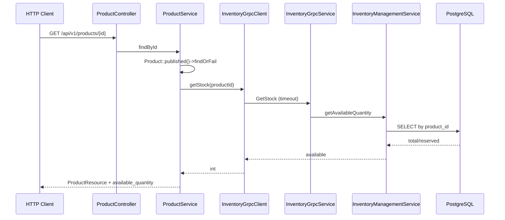

# 02 — تدقيق المتطلب 2: التواصل بين الخدمات والمخزون

**حالة التنفيذ الإجمالية:** **منفَّذ جوهرياً مع أدلة تصميم قوية للاتساق والتزامن، مع فجوة تعويض معروفة عند ضياع رد الحجز بعد النجاح**  
**أساس التحقق:** Java + Laravel + proto + Postman/adversarial-qa (قراءة). **لم يُنفَّذ** تشغيل حي أو k6 في هذا التدقيق.

---

## 1. مصفوفة امتثال المتطلب 2

| # | المعيار | التنفيذ | الدليل | الحالة | تغطية اختبار |
| --- | --- | --- | --- | --- | --- |
| 2.1 | فصل إدارة المخزون كخدمة مستقلة | خدمة Spring منفصلة + DB خاصة | `inventory-service/` + `inventory-db` | **Verified by source code** | contextLoads فقط |
| 2.2 | تواصل عبر gRPC | عميل PHP + خادم Java | `InventoryGrpcClient` + `InventoryGrpcService` | **Verified by source code** | Laravel يحاكي بالمocks في جزء المنتجات |
| 2.3 | لغة/إطار مختلف | PHP/Laravel ↔ Java/Spring | composer + pom | **Verified by source code** | — |
| 2.4 | قاعدة بيانات مستقلة | PostgreSQL مقابل MySQL | Compose | **Verified by source code** | — |
| 2.5 | عقد Protobuf لفحص/حجز/تحرير | proto كامل + Commit/Add/Initialize إضافية | `proto/inventory.proto` | **Verified by source code** | — |
| 2.6 | تفاصيل المنتج تجلب الكمية الحالية | `ProductService::findById` → `getStock` | سطور 33–38 | **Verified by source code** | لا اختبار تكامل حقيقي |
| 2.7 | إنشاء الطلب يتحقق ويحجز كل البنود | `reserveStock` بمجموعة items | `OrderService::createOrder` | **Verified by source code** | Postman/adversarial موثَّق |
| 2.8 | نقص المخزون يرفض دون إنشاء طلب | `success=false` → 409؛ المعاملة تتراجع | Java + Laravel exceptions | **Verified by source code** | Postman folder 04 |
| 2.9 | أعطال/مهل بحدود مفهومة | timeout + 503 رسالة عامة | `services.inventory.timeout`؛ bootstrap | **Verified by source code** | UnifiedErrorResponseTest (محاكاة) |
| 2.10 | فشل حفظ الطلب بعد الحجز يحرّر المخزون | catch + `releaseStock` إن `reservationCreated` | `OrderService` 150–165 | **Partially implemented** | Postman 07 موجود؛ **خلل مهلة** في 08 |
| 2.11 | إثبات تزامن آخر وحدة | أقفال PESSIMISTIC_WRITE + ترتيب معرفات | `InventoryManagementService.reserveStock` | **Verified by source code**؛ الإثبات التشغيلي **Documented but not independently verified** | Postman 04 + adversarial `last-piece` |

---

## 2. معمارية خدمة المخزون (Java)

| البند | القيمة |
| --- | --- |
| Java | 21 |
| Framework | Spring Boot 4.0.9 + spring-grpc-spring-boot-starter |
| منفذ gRPC | 9090 (`application.yaml`) |
| ORM | Spring Data JPA / Hibernate `ddl-auto: update` |
| DB | PostgreSQL 16 |

### المكوّنات

| صنف | الدور |
| --- | --- |
| `InventoryServiceApplication` | نقطة التشغيل |
| `InventoryGrpcService` | تنفيذ RPCs وتحويل الاستثناءات إلى gRPC/رسائل |
| `InventoryManagementService` | منطق الحجز/التحرير/الالتزام/الإضافة |
| `InventoryStockRepository` | قراءة + `findByProductIdForUpdate` بقفل متشائم + `initializeIfAbsent` |
| `InventoryReservationRepository` | استعلام الحجوزات حسب المعرف والحالة |
| `InventoryStock` / `InventoryReservation` | كيانات وجداول |

### نموذج البيانات

- `inventory_stock`: `total_quantity`, `reserved_quantity`؛ المتاح = الفرق.
- `inventory_reservations`: صف لكل منتج ضمن `reservation_id`؛ حالات `ACTIVE`, `RELEASED`, `COMMITTED`.
- قيود CHECK تمنع كميات سالبة أو reserved > total.
- Unique على `(reservation_id, product_id)` و`product_id` في المخزون.

### حدود المعاملات

كل عملية أعمال مزيّنة بـ `@Transactional`. الحجز:

1. يتحقق من عدم تكرار `reservationId`.
2. يرتّب المنتجات بـ `TreeMap` لترتيب أقفال ثابت (تقليل deadlock).
3. يقفل كل صف بـ `PESSIMISTIC_WRITE` ويفحص التوفر **قبل** أي تعديل.
4. يزيد `reserved_quantity` ويكتب صفوف الحجز `ACTIVE`.
5. عند أي نقص يُرمى `InsufficientStockException` فتتراجع المعاملة بالكامل → **ذرية على مستوى سلة متعددة المنتجات**.

الالتزام (`commitReservation`): يخصم من `total` و`reserved` ويعلّم `COMMITTED` (idempotent إن كان ملتزماً مسبقاً).  
التحرير (`releaseStock`): يعيد reserved ويعلّم `RELEASED` (idempotent للتحرير المكرر؛ يرفض تحرير committed).

---

## 3. عقد Protocol Buffers

الملف الرسمي: `proto/inventory.proto` (ونسخة تحت `main-app/laravel/proto/`).

```text
service InventoryService {
  rpc GetStock
  rpc ReserveStock          // حجز ذري متعدد البنود
  rpc ReleaseStock
  rpc AddStock
  rpc InitializeStock       // نفس رسالة AddStockRequest؛ إدراج إن غاب فقط
  rpc CommitReservation
}
```

رسائل أساسية:

- `ReserveStockRequest { reservation_id, repeated StockItem items }`
- `ReserveStockResponse { success, message, reservation_id }`
- `GetStockResponse { product_id, available_quantity }`

التوليد:

- Java: protobuf-maven-plugin من `../proto` أثناء بناء Docker.
- PHP: أصناف تحت `app/Grpc/Generated/Inventory/*` محمّلة عبر `classmap` في `composer.json`.

---

## 4. كيف يتحول طلب Laravel إلى gRPC



عند تعذّر المخزون: `InventoryServiceException` → HTTP 503 «The inventory service is temporarily unavailable.»

---

## 5. تدفق إنشاء الطلب والحجز (تفصيلي)

```mermaid
sequenceDiagram
  participant U as User
  participant OC as OrderController
  participant OS as OrderService
  participant My as MySQL
  participant Inv as Inventory gRPC

  U->>OC: POST /api/v1/orders
  OC->>OS: createOrder(user)
  OS->>My: BEGIN; lock cart + cart_items
  OS->>OS: بناء reservationItems من السلة
  OS->>Inv: ReserveStock(uuid, items)
  alt نقص مخزون
    Inv-->>OS: success=false
    OS-->>U: 409؛ Rollback MySQL؛ لا طلب
  else نجاح الحجز
    Inv-->>OS: success=true
    Note over OS: reservationCreated=true
    OS->>My: INSERT order + items؛ DELETE cart_items؛ COMMIT
    OS-->>U: 201 Order
  else فشل بعد نجاح الحجز
    OS->>Inv: ReleaseStock(compensation)
    OS-->>U: خطأ أصلي (مثلاً 500)
  end
```

### حدود المعاملات عبر النظامين

- **لا توجد معاملة موزّعة (2PC/XA).**
- نمط التعويض: إن رُفع استثناء بعد `reservationCreated=true` يُستدعى `releaseStock`.
- استدعاء gRPC يحدث **داخل** `DB::transaction` بينما السلة مقفلة بـ `lockForUpdate` — يحمي من سباق سلة المستخدم نفسه لكنه يطيل أقفال MySQL أثناء الشبكة.

### هل الحجز ذري لكل البنود؟

نعم على جانب Java: كل البنود تُفحص وتُحدَّث في معاملة واحدة؛ نقص أي منتج يلغي الكل. العميل يرسل العناصر في RPC واحد.

### الموثوقية عند ضياع الرد (خلل معروف)

إذا اكتمل `ReserveStock` في PostgreSQL لكن عميل PHP انتهت مهلته قبل استلام الرد:

1. يُرمى `InventoryServiceException`.
2. `reservationCreated` يبقى `false` لأن السطر الذي يضبطه يأتي **بعد** عودة `reserveStock` بنجاح.
3. **لا يُستدعى** `releaseStock` في التعويض.
4. معاملة MySQL تتراجع → لا طلب، لكن الحجز يبقى `ACTIVE` في المخزون.

هذا موثَّق صراحة في Postman تحت **`08 gRPC Deadline - Known Bug`** وفي `adversarial-qa/README.md`.

سيناريو Postman **`07 Order Save Failure`** يغطي الحالة المعاكسة: الحجز نجح وردّه وصل ثم فشل INSERT الطلب → التعويض يحرّر المخزون (مسار الكود يدعم ذلك).

---

## 6. التزامن ومنع البيع الزائد

### الآلية الفعلية (Verified by source code)

1. `SELECT ... FOR UPDATE` عبر `@Lock(PESSIMISTIC_WRITE)`.
2. فحص `available < requested` قبل التحديث.
3. ترتيب أقفال المنتجات تصاعدياً.
4. قيود CHECK على مستوى القاعدة كشبكة أمان إضافية.
5. رفض تكرار نفس `reservation_id`.

### سيناريو وحدتين تتنافسان على آخر قطعة

| الخطوة | ماذا يحدث |
| --- | --- |
| كلا الطلبين يصلان `ReserveStock` | المعاملات تتسلسل على صف المخزون |
| الأول يقفل الصف ويحجز 1 | reserved += 1؛ available يصبح 0 |
| الثاني ينتظر القفل ثم يرى available=0 | `InsufficientStockException` → `success=false` |
| Laravel للخاسر | 409 دون إنشاء طلب |
| الفائز | ينشئ الطلب إن نجح حفظ MySQL |

**هل الضمان موجود؟** على مستوى خدمة المخزون: **نعم وفق منطق القفل**.  
**هل أُثبت تشغيلياً في هذا التدقيق؟** **لا** — لم تُشغَّل الحاويات ولا k6. الأدلة الجاهزة للعرض: مجلد Postman 04 و`adversarial-qa` case `last-piece`.

### اختبارات التزامن داخل المستودع

- لا يوجد اختبار PHPUnit تزامني حقيقي متعدد العمليات.
- `adversarial-qa/audit.js` مصمّم لإرسال checkouts متوازية عبر k6.
- اختبار Java لا يغطي السباقات.

---

## 7. سيناريوهات الفشل

| # | السيناريو | المسار الفعلي | نتيجة ظاهرة | اتساق البيانات | اختبارات | حماية ناقصة؟ |
| --- | --- | --- | --- | --- | --- | --- |
| 1 | نقص مخزون | Reserve success=false → 409 | لا طلب؛ السلة تبقى (rollback) | سليم | Postman 04 | — |
| 2 | خدمة مخزون متوقفة | فشل قناة → 503 | قائمة منتجات قد تنجح؛ التفاصيل/Checkout تفشل | لا حجز | Postman 06 | app لا يعتمد على inventory في Compose |
| 3 | مهلة gRPC | timeout → 503 | انظر خلل الحجز اليتيم | **خطر حجز يتيم** | Postman 08 | تعويض لا يعمل إذا ضاع الرد |
| 4 | حجز نجح + فشل حفظ الطلب | compensation release | 5xx؛ يفترض تحرّر المخزون | سليم إن نجح release | Postman 07 | إن فشل release → critical log فقط |
| 5 | فشل التحرير أثناء التعويض | `Log::critical` ثم إعادة رمي الخطأ الأصلي | مستخدم يرى فشل الطلب؛ مخزون محجوز | **عدم اتساق محتمل** | — | لا طابور إعادة محاولة/reconcile |
| 6 | تكرار إرسال الطلب | لا idempotency على orders؛ السلة تُفرَّغ بعد النجاح | طلب ثانٍ يفشل إن السلة فارغة؛ إن تزامن قبل التفريغ فالقفل يساعد | يعتمد | adversarial `duplicate-checkout` | لا مفتاح Idempotency للطلبات |
| 7 | checkout متزامن لآخر وحدة | أقفال Postgres | واحد ينجح | مصمّم ليكون سليماً | Postman 04 | يحتاج عاملَي gateway أحياناً حسب QA README |
| 8 | بيانات مخزون قديمة في الواجهة | القائمة بلا كمية؛ التفاصيل قراءة مباشرة | قد يضيف للسلة كمية أكبر من المتاح | الرفض عند الحجز | — | السلة لا تتحقق من المخزون مسبقاً |
| 9 | فشل شبكة جزئي | يعتمد أين انقطع | 503 أو 409 | خطر يتيم عند انقطاع بعد commit المخزون | fault-relay | — |
| 10 | إعادة تشغيل أثناء العملية | حالة غير محدّدة دون saga persist | — | **Unable to determine** بدون تجارب | — | لا outbox |

---

## 8. تدفق قراءة المنتج وربطه بالمخزون (إجابات مطلوبة)

1. المسار: `GET /api/v1/products/{id}` — `Products/Routes/api.php`.
2. المتحكم: `ProductController::show`.
3. التحميل: `Product::published()->with('category')->findOrFail`.
4. الاستدعاء: `InventoryGrpcClient::getStock`.
5. الـ RPC: `GetStock`.
6. الإرجاع: `available_quantity` على النموذج ثم `ProductResource`.
7. الاستجابة النهائية JSON موحّدة success/message/data.
8. إن تعذّر المخزون: 503 بدون تفاصيل داخلية.

---

## 9. خطة عرض للجنة (متطلب 2)

```powershell
docker compose up -d --wait
docker compose logs --tail 30 inventory-service
# ابحث عن: gRPC Server started
```

| العرض | ماذا تفعل | النتيجة المتوقعة |
| --- | --- | --- |
| كمية المنتج | `GET /products/{id}` | `available_quantity` |
| نقص مخزون | سلة فيها كمية أكبر من المتاح ثم `POST /orders` | 409؛ لا صف في `orders` |
| تعطيل المخزون | `docker compose stop inventory-service` ثم تفاصيل منتج/checkout | 503؛ القائمة قد تعمل |
| سباق آخر قطعة | حسابا Daniel/Olivia مع Sony في السلة أو سكربت Postman 04 | طلب واحد ينجح |
| تعويض حفظ فاشل | سيناريو Postman 07 (يتطلب تلاعباً بـ MySQL في مختبر) | المخزون يعود |
| الإفصاح عن الخلل | شرح مجلد 08 بصدق هندسي | يظهر فهم حدود التعويض |

فحص قواعد البيانات (عرض فقط):

```powershell
docker compose exec -T mysql mysql -uecommerce_user -p... ecommerce_main -e "SELECT id,status,reservation_id FROM orders ORDER BY id DESC LIMIT 5;"
docker compose exec -T inventory-db psql -U inventory_user -d ecommerce_inventory -c "SELECT product_id,total_quantity,reserved_quantity FROM inventory_stock ORDER BY product_id;"
```

> لا تُدرج كلمات المرور في العروض المكتوبة؛ استخدم المتغيرات البيئية المحلية أو الإدخال التفاعلي.

---

## 10. أسئلة متوقعة وإجابات نموذجية

**س: هل لديكم معاملة موزّعة؟**  
ج: لا. نستخدم حجزاً في خدمة المخزون ثم تعويضاً (`ReleaseStock`) إن فشل إنشاء الطلب في Laravel.

**س: كيف تمنعون البيع الزائد؟**  
ج: قفل صف متشائم في PostgreSQL داخل معاملة واحدة تفحص كل البنود قبل التحديث، مع ترتيب معرفات المنتجات.

**س: متى يُخصم المخزون فعلياً؟**  
ج: عند انتقال الطلب إلى `shipped` عبر `CommitReservation`. قبل ذلك الكمية محجوزة فقط.

**س: ماذا لو انتهت مهلة gRPC بعد نجاح الحجز؟**  
ج: هذه فجوة معروفة حالياً: Laravel قد لا يحرّر الحجز لأن علم التعويض لا يُضبط إلا بعد استلام النجاح. يمكن اقتراح outbox/TTL للحجوزات أو idempotent retry بمفتاح معروف كتحسين.

---

## 11. الحكم النهائي للمتطلب 2

التنفيذ يلبي جوهر الفصل الخدمي، العقد، الحجز الذري، رفض النقص، مهلة محدودة، والتعويض في مسار «الرد وصل ثم فشل الحفظ».  
لإعلان الاكتمال أمام اللجنة يجب:

1. عرض سباق آخر قطعة بنجاح.
2. عرض 503 عند التوقف.
3. الإفصاح عن خلل المهلة أو إصلاحه قبل التسليم النهائي إن اعتُبر معيار قبول صارم.
